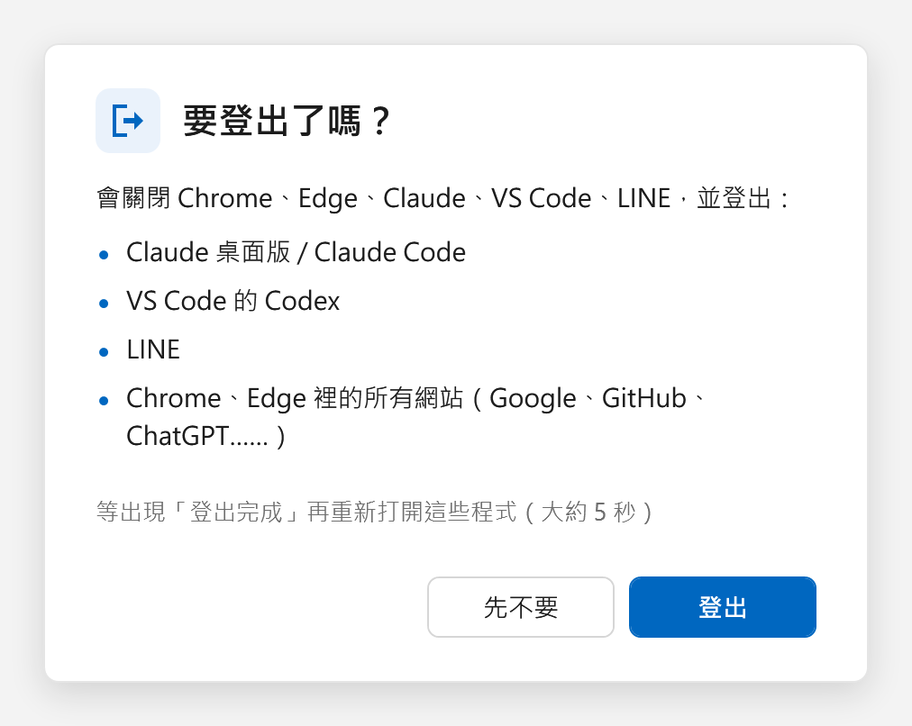

# 一鍵登出

共用電腦（教室、實驗室、家人共用的電腦）用完，點一下就把自己的帳號全部登出。



## 會做什麼

關閉下列程式，並刪除「登入用的 cookie / token」，下次打開要重新登入：

- **Claude 桌面版**、**Claude Code**
- **VS Code 的 Codex**
- **LINE 電腦版**（安裝在 `%LOCALAPPDATA%\LINE` 的一般版，不是 Microsoft Store 版）
- **Chrome、Edge 裡的所有網站**（Google、GitHub、ChatGPT……全部）

整個流程大約 5 秒，結束時會跳出結果視窗，逐項列出登出成功與否。

## 不會做什麼

- 不刪書籤、瀏覽紀錄、儲存的密碼、下載內容
- 不刪 LINE 聊天紀錄
- 不改系統設定，不需要系統管理員權限
- 不安裝任何東西（只用 Windows 內建的 PowerShell 和 `winsqlite3.dll`）

## 使用方式

1. 下載整個資料夾，放在任何地方（路徑可以有中文）。
2. 雙擊 `一鍵登出.cmd`。
3. 看到確認視窗，按「登出」或 Enter；「先不要」或 Esc 取消。
4. 等「登出完成」出現再重新打開程式。

想放在桌面上：雙擊 `建立桌面捷徑.cmd`，會在桌面建立一個附圖示、不閃黑色視窗的捷徑。

## 進階用法

```bat
powershell -ExecutionPolicy Bypass -File 一鍵登出.ps1 -DryRun
```

| 參數 | 說明 |
|---|---|
| `-DryRun` | 演練：不關程式、不刪任何東西，只回報「會刪掉什麼」 |
| `-TestRoot <資料夾>` | 測試：只對該資料夾裡的假資料動手，不碰真正的登入資料 |
| `-Yes` | 不跳確認和結果視窗，直接執行（排程或其他腳本呼叫時用） |

執行紀錄在 `%TEMP%\一鍵登出-紀錄.txt`，每一步的結果和重試次數都在裡面。

## 運作方式

- 先刪 Claude Code 和 Codex 的登入檔，同時請瀏覽器和 VS Code 開始關閉。
- Claude 桌面版被關掉後 1 秒內會自己重開並鎖住檔案，所以對它採取「強制結束、立刻清除、失敗就重試」的做法，最多 20 次。
- Chrome / Edge 用 SQLite 直接清空每個設定檔的 cookie 資料表和瀏覽器帳號 token，其他資料表不動。
- 六個步驟各自獨立，一步失敗不影響其他步驟。
- 開始時會用 WMI 另外啟動一個備援程序；主程序中途被關掉的話，備援程序會接手沒做完的步驟。
- 結果視窗放在 `finally` 裡，不管中途發生什麼事都會顯示。

## 已知限制

- 少數網站把登入狀態放在 Local Storage 或 IndexedDB 而不是 cookie（例如 Discord 網頁版、部分用 Firebase 的網站），這些不會被登出。
- 只處理 Chrome 和 Edge，Firefox 和其他瀏覽器不處理。
- LINE 只處理一般安裝版；Microsoft Store 版的資料位置不同。
- 不要從 Claude 桌面版或 VS Code 裡面的終端機執行，它們一被關掉，腳本也會跟著結束。請用 `.cmd` 或桌面捷徑。

## 需求

Windows 10 / 11，內建的 Windows PowerShell 5.1 即可。

## 檔案

| 檔案 | 說明 |
|---|---|
| `一鍵登出.ps1` | 主程式（UTF-8 含 BOM，改完請保留 BOM） |
| `一鍵登出.cmd` | 雙擊執行用 |
| `建立桌面捷徑.cmd` / `.ps1` | 在桌面建立捷徑 |
| `圖示\一鍵登出.ico` | 捷徑圖示 |
| `預覽.png` | 確認視窗的樣子 |
